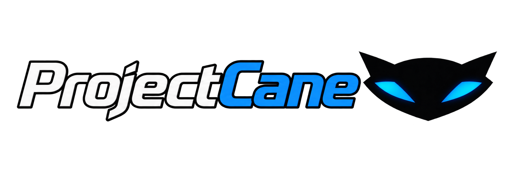

# ProjectCane

ProjectCane is a playable PC port of the NTSC release of *Sly Cooper and the Thievius Raccoonus*. The project originally began as a map viewer, but it has since grown into a complete playable port.

> **Platform support:** ProjectCane currently supports Windows only. Linux compatibility is planned for a future release.

## Requirements

- Windows
- Visual Studio 2022 with the **Desktop development with C++** workload
- A legally obtained NTSC ISO of *Sly Cooper and the Thievius Raccoonus*

ProjectCane does not include the original game's copyrighted data. You must extract the required files from your own NTSC copy of the game.

## Setup

1. Clone or download this repository.
2. Open `ProjectCane.sln` in Visual Studio 2022.
3. In **Solution Explorer**, right-click the **File Extractor GUI** project and select **Set as Startup Project**.
4. Build and run the **File Extractor GUI** project.
5. In the extractor, select your legally obtained NTSC *Sly Cooper and the Thievius Raccoonus* ISO.
6. Choose an installation folder, click **Extract Files**, and wait for the extraction to finish completely.
7. Return to Visual Studio, right-click the **Sly1-Release** project, and select **Set as Startup Project**.
8. Build the **Sly1-Release** project.
9. Copy the built `Sly Cooper and the Thievius Raccoonus.exe` into the installation folder selected in the extractor.
10. Run `Sly Cooper and the Thievius Raccoonus.exe` to play.

No external shader files are required—the shaders are embedded in the executable.

## Status

The full game is playable. Development is continuing with bug fixes, compatibility improvements, and future Linux support.

## Help Bring Sly 2 and Sly 3 to PC

ProjectCane is not intended to stop with *Sly Cooper and the Thievius Raccoonus*. The goal is to bring *Sly 2: Band of Thieves* and *Sly 3: Honor Among Thieves* to PC as native ports as well.

If you know where to find a debug build of *Sly 2* or *Sly 3* that includes debug symbols, please let me know. You can contact me at [projectcane182@gmail.com](mailto:projectcane182@gmail.com).

If you would like to see native PC ports of all three games up and running, any information that can help make that possible would be greatly appreciated. Thank you!
